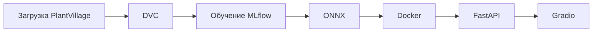

# Классификация заболеваний растений

Назначение: по фотографии листа определить, здоров ли он и какая это болезнь. Восемь классов, три культуры: яблоня, томат, картофель.

Схема пути данных: [docs/architecture.svg](docs/architecture.svg).



## Требования

- Python 3.11. В `pyproject.toml` указано `>=3.11,<3.12`.
- Poetry 2.
- Git, чтобы скачать PlantVillage и посмотреть SHA.
- Docker, если нужен образ. Проверенный тег: `plant-disease-clf:1.0.0-4c2cc99`.

Проверено на Windows: Python 3.11.9 и Poetry 2.5.2.

## Зависимости

Отдельные пакеты через pip ставить не нужно: версии берутся из `poetry.lock`. PyTorch и torchvision ставятся из CPU-индекса, без CUDA.

Если команды `poetry` нет, официальный установщик в PowerShell:

```powershell
(Invoke-WebRequest -Uri https://install.python-poetry.org -UseBasicParsing).Content | py -3.11 -
```

Каталог `%APPDATA%\Python\Scripts` нужно добавить в `PATH`. На Linux и macOS тот же установщик:

```bash
curl -sSL https://install.python-poetry.org | python3.11 -
```

Дальше из корня репозитория:

```powershell
poetry env use 3.11
poetry install
Copy-Item .env.example .env
```

На Linux и macOS последняя команда: `cp .env.example .env`. Окружение появляется в `.venv/`.

## Данные и модель

Источник, лицензия, сплит и версии препроцессинга описаны в [DATASET_CARD.md](DATASET_CARD.md). Скачивание и проверка манифеста:

```powershell
poetry run python scripts/download_plantvillage.py
poetry run python scripts/make_split.py
poetry run python scripts/write_checksums.py
```

Ожидаемый sha256 манифеста: `c492e8872d6d20fb7ca19cbb70e750a412e66ac0ecbccf3458c13704b6a82a93`.

Снимки лежат в `data/filtered` и отслеживаются DVC. Общего удалённого хранилища нет, секрет для него не нужен: преподаватель получает те же файлы скриптом выше. Веса `artifacts/best_model.pt` тоже в DVC, не в git. ONNX рядом: `artifacts/best_model.onnx`, его собирает `scripts/export_onnx.py`. Карточка модели: [MODEL_CARD.md](MODEL_CARD.md).

## Конфигурация

Формат — YAML.

- `configs/train.yaml` — данные, модель, обучение, аугментации, `split_seed` 42, версии `v1_baseline` и `v2_augmented`.
- `configs/inference.yaml` — версия препроцессинга `v1_baseline` и лимиты сервера.

Пути к данным и модели в YAML не записаны. Их задают `DATA_DIR` и `MODEL_ARTIFACT_PATH`, шаблон — `.env.example`. Если обязательного значения нет, загрузка останавливается короткой ошибкой, например: `Не задан обязательный параметр: DATA_DIR.`

## Обучение

Общие параметры читает `load_train_config()`. Три опыта:

```powershell
poetry run python scripts/run_experiment.py exp1_mobilenet_frozen
poetry run python scripts/run_experiment.py exp2_mobilenet_finetune
poetry run python scripts/run_experiment.py exp3_efficientnet_early_stop
```

Чекпоинт выбирается по val. Test считается один раз в конце. Локальный MLflow пишет каталог `mlruns/`, в git он не входит. Итог уже посчитан: run `5fd5ed281bce46088edaef1277d0d4fd`, сравнение в `experiments/summary.json`.

## Тесты

```powershell
poetry run pytest
```

Проверяются конфиг, `/health`, `/predict`, схема ответа и preprocessing без загрузки модели.

## Сервис

Локально, на чекпоинте PyTorch:

```powershell
$env:MODEL_ARTIFACT_PATH = "artifacts/best_model.pt"
poetry run uvicorn plant_disease.service:create_app --factory
```

Если путь оканчивается на `.onnx`, тот же процесс считает через onnxruntime.

`GET /health`:

```json
{"status":"ok","model_loaded":true,"model_version":"5fd5ed281bce46088edaef1277d0d4fd","preprocess_version":"v1_baseline"}
```

`POST /predict` с файлом изображения:

```powershell
curl.exe -F "file=@tests/fixtures/late_blight.jpg;type=image/jpeg" http://127.0.0.1:8000/predict
```

Ответ содержит класс `Tomato___Late_blight`, уверенность, распределение вероятностей, версию модели и версию preprocessing. Документация: `http://127.0.0.1:8000/docs`.

## Docker

Сборка. Тег содержит версию и короткий SHA, тега `latest` нет:

```powershell
docker build -t "plant-disease-clf:1.0.0-$(git rev-parse --short HEAD)" .
```

Проверенный образ: `plant-disease-clf:1.0.0-4c2cc99`. Запуск, модель только томом:

```powershell
docker run --rm -p 8000:8000 -e MODEL_ARTIFACT_PATH=/models/best_model.onnx -v "./artifacts:/models:ro" plant-disease-clf:1.0.0-4c2cc99
```

Проверка: `bash scripts/smoke_test.sh`.

## Интерфейс

Сначала сервис, затем интерфейс в другом терминале. Адрес API читается из `API_URL`.

```powershell
$env:API_URL = "http://127.0.0.1:8000"
poetry run python scripts/ui.py
```

На экране класс, уверенность и версия модели. Ошибка сервиса показывается текстом. Своей модели в интерфейсе нет.

## Структура

- `plant_disease/` — данные, обучение, препроцессинг, сервис.
- `configs/` — YAML обучения и инференса.
- `scripts/` — скачивание, сплит, опыты, экспорт ONNX, интерфейс, smoke test.
- `splits/` — манифест сплита и спецификации препроцессинга.
- `experiments/` — описание опытов и `summary.json`.
- `tests/` — pytest и маленькие примеры изображений.
- `docs/architecture.svg` — схема пути данных.
- `artifacts/` — веса, в git не входят. Рядом лежат только указатели DVC.
